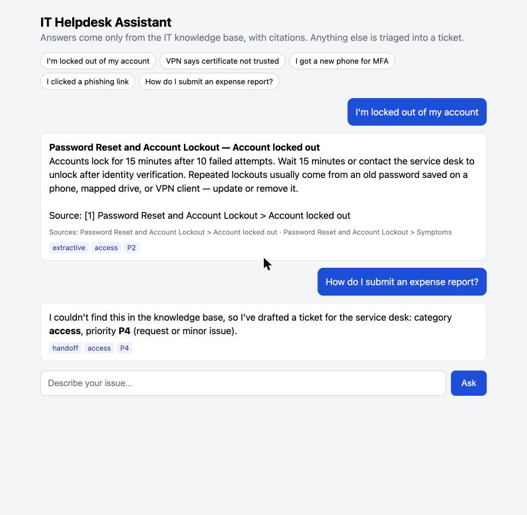

# IT Helpdesk AI Assistant


A **retrieval-augmented generation (RAG)** service desk assistant. It answers employee IT questions **only** from a curated knowledge base, cites its sources, redacts personal data before anything reaches a language model, and hands off to a human with an auto-triaged ticket when the knowledge base doesn't cover the question.

It works out of the box with **no API key** (extractive answers). Set Azure OpenAI or OpenAI credentials and it generates grounded, step-by-step answers instead.



## Features

- **Knowledge grounding** – markdown KB articles are chunked by section and indexed with **BM25** (implemented from scratch), with title boosting and synonym expansion
- **Confidence gate** – low-relevance retrievals are never answered; the assistant hands off instead of hallucinating
- **Citations** – every answer lists the KB article and section it came from
- **Responsible AI guardrails** – emails, phone numbers, SSNs, card numbers, and "password is …" phrases are redacted before retrieval or LLM calls; the system prompt forbids answering outside the provided excerpts
- **Ticket triage** – a from-scratch **multinomial Naive Bayes** classifier predicts category (access, network, hardware, software, security), and explainable rules assign priority P1–P4
- **LLM integration** – Azure OpenAI or OpenAI Chat Completions over plain HTTPS, with automatic fallback to extractive answers if the call fails
- **Evaluation harness** – hit@1, hit@3, MRR, out-of-scope hand-off rate, and triage accuracy, enforced as a **quality gate in CI**
- **Web chat UI + JSON API** – standard library only (`http.server`)

## Evaluation Results

```
$ python -m helpdesk eval
retrieval_hit@1              0.95
retrieval_hit@3              1.0
retrieval_mrr                0.975
out_of_scope_handoff_rate    1.0
triage_category_accuracy     1.0
triage_priority_accuracy     1.0
```

Measured on 20 held-out user-phrased questions, 3 out-of-scope questions, and 8 held-out tickets (`data/eval_set.json`).

## Quick Start

Python 3.9+, no third-party packages.

```bash
git clone https://github.com/okrahgadiel/helpdesk-ai-assistant.git
cd helpdesk-ai-assistant

python -m helpdesk ask "VPN says certificate not trusted"
python -m helpdesk triage "the whole floor lost wifi"
python -m helpdesk eval
python -m helpdesk serve            # open http://127.0.0.1:8000
```

### Use Azure OpenAI (optional)

```bash
export AZURE_OPENAI_ENDPOINT="https://<resource>.openai.azure.com"
export AZURE_OPENAI_API_KEY="..."
export AZURE_OPENAI_DEPLOYMENT="gpt-4o-mini"
```

Or set `OPENAI_API_KEY` for OpenAI. Keys are read from the environment only and never logged.

## Architecture

```
question ──▶ redact PII ──▶ BM25 retrieve (top-k KB sections)
                                   │
                    score < threshold? ──yes──▶ hand off: Naive Bayes category + rule-based priority
                                   │no
                                   ▼
            Azure OpenAI / OpenAI (grounded prompt, temperature 0.1)   ──fallback──▶ extractive answer
                                   │
                                   ▼
                   answer + citations + triage tags  ──▶  CLI / web UI / JSON API
```

```
helpdesk/
  retriever.py   tokenizer, KB chunking, BM25
  triage.py      Naive Bayes classifier, priority rules
  assistant.py   RAG pipeline, PII redaction, LLM clients
  evaluate.py    offline metrics
  server.py      web UI + /api/ask
knowledge_base/  12 IT support articles (markdown)
data/            labeled tickets and evaluation set
```

## Extending

- **Add knowledge**: drop a markdown file into `knowledge_base/` using `#` for the title and `##` for each section. No retraining needed.
- **Improve triage**: append labeled rows to `data/tickets.csv`.
- Microsoft-stack equivalent: the same KB can serve as a knowledge source for a Copilot Studio agent, with Power Automate creating the ServiceNow ticket on hand-off.

## License

MIT
